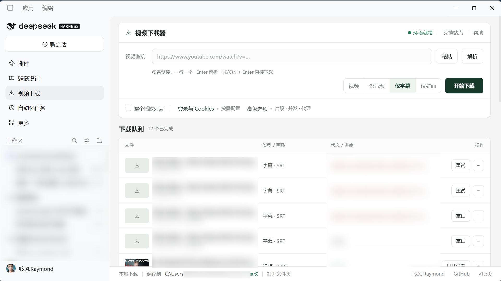

# 视频下载器 · DeepSeek Harness 插件

侧栏「视频下载」入口 + 主区域页面：贴一个链接，用本机 `yt-dlp` 下载视频 / 音频 / 字幕 / 封面，进度实时刷新。

支持 YouTube、哔哩哔哩、X、TikTok 等上千个站点——它本质上是一个 yt-dlp 的图形前端。


> **仅供个人学习与备份使用。** 本项目不托管、不分发任何内容，所有下载都在你自己的电脑上、通过你自己安装的 yt-dlp 完成；请遵守你所在地区的法律和所用平台的服务条款。详见[免责声明](#disclaimer)。


## 功能

- **自动找命令**：插件自带的单文件版 → `yt-dlp` → `python3 -m yt_dlp` → `python -m yt_dlp` → `py -3 -m yt_dlp`，依次探测，不用配 PATH。
- **一键安装 yt-dlp**：没装时点一下，自动下载**对应系统**的官方单文件版（Windows `yt-dlp.exe`、macOS `yt-dlp_macos`、Linux 对应架构），**不需要 Python**；直连 GitHub 超时会自动换加速镜像，再不行退回 `pip install`（系统 Python 或 DSH 自带的那个）。
- **一键安装 ffmpeg**：ffmpeg 才是难装的那一个。插件从 PyPI 的 `imageio-ffmpeg` 轮子里取出官方静态构建，装进插件自己的 `bin/` 目录——**不需要 Homebrew、不需要 sudo、不需要能写 `/usr/local/bin`**，装完直接用 `--ffmpeg-location` 指给 yt-dlp。
- **没有 ffmpeg 也不炸**：高清合并、转 mp3、字幕转 srt、字幕内嵌、封面转 jpg 都依赖 ffmpeg。缺它时插件会**降级到能下下来的形态**（单文件画质 / 原始音频 / 原始 vtt / 原始封面），并在那一行写清降级了什么，而不是丢一堆 `ERROR` 让人重试。
- **跨平台启动**：从桌面 / Dock 点开 App 时系统不给 shell 的 PATH，插件会自己补上 `/opt/homebrew/bin`、`/usr/local/bin`、`~/.local/bin` 等位置，brew 装的 yt-dlp / ffmpeg 也能找到；插件 `bin/` 里的二进制永远优先。
- **界面**：单列卡片（链接 → 解析结果 → 模式 / 画质 → 开始下载）+ 队列表格（文件 / 类型 / 进度 / 操作），浅色为主，跟随系统深色模式。
- **解析预览**：标题、UP 主、时长、播放量、封面、可选清晰度、字幕数量。
- **下载前试看**：点封面上的「▶ 试看」，直接在页面里播放（取一条临时直链，不落盘）。
- **四种模式**：视频（最佳 / 2160p / 1440p / 1080p / 720p / 480p / 360p）、仅音频（MP3）、仅字幕（srt）、仅封面（jpg）。
- **视频加料**：内嵌中英文字幕（可选额外保留 .srt）、整播放列表。
- **高级**：时间片段（`00:30-01:30`）、播放列表范围（`1:10`）、跳过已下载、代理、限速、并发 1–3、完成后自动打开。
- **队列**：并发下载、实时百分比 / 速度 / 剩余时间、单任务**暂停 / 继续**（从断点续传）、取消、失败一键重试；每行显示**视频名**（从 yt-dlp 的落盘文件名解析，链接只在悬停时显示），方便搜索和对号。
- **检查更新**：点页脚版本号，自动比对 GitHub 上的最新版本；能 git pull 的直接更新，装成副本的给你一句可直接发给 Harness 的更新指令。
- **Agent 工具**：除了点面板，也能在对话里直接让 Harness 下载、查询、暂停（见下）。
- **Cookies**：上传 cookies.txt 长期生效，也能直读 Edge / Firefox 的 Cookie。
- **保存位置**：默认 `~/Downloads/YT-DLP`，可随时更换。

## 在对话里用（Agent 工具）

插件给 Agent 注册了 4 个工具，聊天里直接说就行，不需要你自己拼命令行：

| 工具 | 作用 |
| --- | --- |
| `video_probe` | 解析链接：标题、作者、时长、可选清晰度、字幕数量、是否直播 |
| `video_download` | 把链接加进队列（`video` / `audio` / `subs` / `thumb`），立刻返回任务编号，不等下载完成 |
| `video_jobs` | 查任务状态、进度、成品文件路径、错误原因 |
| `video_control` | `cancel` 取消 / `pause` 暂停 / `resume` 继续（断点续传） |

可以这么说：

> 帮我把这个视频的字幕下下来，然后读一遍整理成中文要点：https://www.youtube.com/watch?v=...

> 把这个视频下成 720p，下完告诉我文件在哪。

> 刚才那个任务暂停一下。

原理：插件在 Host 进程里把「工具名 + 用途 + 参数」注册给 Agent，模型根据你的话生成参数，DSH 校验后调用插件里同一套 `startDownload()` / `probe()` / `cancelJob()`，所以 Agent 发起的任务和你点面板发起的任务**在同一个队列里**——面板能看到进度，你也能手动暂停或取消。

两个刻意的设计：
- `video_download` 只返回「任务已创建」，不等下载完成（大视频要几十分钟，工具会超时）；
- 凭据不走工具参数，cookies 固定用本机已存的那份，避免被写进对话日志。


## 支持的站点（常用）

| 分类 | 站点 |
| --- | --- |
| 视频 | YouTube、哔哩哔哩、Vimeo、优酷、爱奇艺、AcFun、Dailymotion |
| 社交 | X（Twitter）、TikTok、Instagram、小红书、微博、抖音、Facebook |
| 音乐 | SoundCloud、Bandcamp、QQ音乐、网易云音乐、喜马拉雅 |
| 直播 | Twitch、斗鱼、虎牙 |

以上都在 yt-dlp 的 extractor 列表里（`yt-dlp --list-extractors` 可查），全部站点有上千个。

面板里的站点图标来自各平台官方标识，仅用于说明"支持哪些站点"，版权归各自所有；需要移除或替换告诉我即可。

**什么时候才需要 cookies.txt**：公开内容通常直接贴链接就能下（实测 YouTube、X、哔哩哔哩的公开视频不带 cookie 也能解析）。真正需要的是会员专属、年龄限制、地区限制的内容，以及偶尔出现的「确认你不是机器人」风控提示。做法：用浏览器扩展 **Get cookies.txt LOCALLY** 在目标站点导出，然后在面板点「上传 cookies.txt」。

面板里鼠标移到「如何导出 cookies.txt，点击查看」会弹出下面这张流程图的缩略预览，点一下看大图：


## 致谢：基于 yt-dlp

本插件是 [yt-dlp](https://github.com/yt-dlp/yt-dlp) 的图形前端——真正解析、下载、合并的工作全部由它完成，这里只负责界面、队列和参数组装。

**授权情况**：yt-dlp 使用 [Unlicense](https://github.com/yt-dlp/yt-dlp/blob/master/LICENSE)（公有领域）。该协议不要求署名、不要求衍生作品同协议开源，也没有任何"必须展示 logo"的条款，所以本项目在法律上不需要为它做任何事。这里仍然明确写出来，是因为：

- 用户应该知道下载能力来自 yt-dlp，遇到站点解析问题去它的仓库反馈更有效；
- 它背后的 youtube-dl 社区和贡献者值得这一句署名。

**唯一要注意的**：别用 "yt-dlp 官方"、"official" 之类的说法暗示隶属关系——这是商标/署名礼仪问题，不是协议要求。本项目在 `package.json` 和 README 里都只写"基于 / powered by"。

## 安装

仓库：<https://github.com/Raymond-Hear/dsh-video-downloader>

### 方式一：跟 Harness 说一句话（最省事）

打开 DeepSeek Harness，把下面这句发给它：

> 帮我安装这个插件：https://github.com/Raymond-Hear/dsh-video-downloader

Agent 会调用 `plugin_manager` 的 `install_bundle`，把仓库地址当成安装源（git 规格）拉下来，装进当前 profile 并默认启用，**不需要手动改任何配置文件**。插件安装需要 `danger-full-access` 权限，所以会让你批准一次；批准后等它跑完就行。两种写法都实测可用：`https://github.com/Raymond-Hear/dsh-video-downloader` 和 `github:Raymond-Hear/dsh-video-downloader`。

装好后点侧栏「视频下载」即可使用；想确认是否装上：设置 → 插件，能看到「视频下载器」这一行。

### 方式二：先 clone，再装本地目录

如果你的 Harness 版本不接受 git 地址安装，就走这条：

```bash
git clone https://github.com/Raymond-Hear/dsh-video-downloader.git
```

然后让 Agent 执行 `plugin_manager install_bundle`，target 填**克隆下来的目录绝对路径**；也可以在插件管理页面里选这个目录安装。

### 方式三：npm 包（维护者发布后可用）

`npm publish` 之后，别人可以直接安装 `dsh-video-downloader` 这个包名（发布前需删掉 `package.json` 里的 `"private": true`）。

### 装完第一次打开

- 本机没有 yt-dlp 时，页面顶部会出现「一键安装 yt-dlp」按钮：先下载当前系统的官方单文件版（不依赖 Python），GitHub 直连超时就依次换加速镜像，最后才退回 `pip install`。
- 没有 ffmpeg 时会出现黄色提示条 + 「一键安装 ffmpeg」：从 PyPI 取静态构建放进插件 `bin/`，不需要 Homebrew。不装也能用，只是高清合并 / MP3 / 字幕转 srt 会降级。
- 默认保存到 `~/Downloads/YT-DLP`，可在页面底部改。

### 更新与卸载

- **检查更新**：点页面右下角的版本号（`v1.3.0`）。有新版本时它会变成 `v1.1.0 → v1.3.0`，点开是个弹窗：
  - 插件目录本身是 git 仓库（本地 clone / `link:` 安装）→ 直接「立即更新」，跑 `git pull --ff-only`；更新完刷新页面看界面变化，Host 侧改动需要重启 Harness。
  - Harness 把插件装进了 profile（副本）→ 插件自己没法替换文件，弹窗会给一句可以直接发给 Harness 的话，复制过去让它重装即可。
- 版本号来自 GitHub 上的 `package.json`（jsdelivr 优先，raw / GitHub API 兜底），不依赖插件自己发起下载。
- **卸载**：插件管理器里移除这个 bundle。下载好的文件、以及 `%LOCALAPPDATA%\dsh-ytdlp\`（macOS / Linux 在 `~/.local/share/dsh-ytdlp/`）里的记录不会被删除。

## 依赖与本机环境

| 依赖 | 是否需要 | 说明 |
| --- | --- | --- |
| yt-dlp | 必须 | 插件会先找自带的，再找 PATH / Python 模块；都没有时页面上一键安装 |
| ffmpeg | 强烈建议 | 高清合并、MP3 转码、字幕转 srt、字幕内嵌、封面转 jpg 都要它；缺失时自动降级，也可以页面上一键安装 |
| Python | 不需要 | 单文件版自带解释器；只有连单文件版都下不下来时，才用 pip 兜底（系统 Python 或 DSH 自带的那个） |

ffmpeg 缺失时页面顶部会显示黄色提示条，点「一键安装 ffmpeg」即可；已经用 `brew` / `winget` 装过的，点「重新检测」也能认出来。

### 在 Mac 上（尤其是没装过开发工具的新机器）

有台 macOS 26 / Apple Silicon 的实机跑过一遍：**没有 Homebrew、没有 sudo、`/usr/local/bin` 根本不存在**，`/usr/bin/python3` 只是 Xcode 命令行工具里的 3.9.6。这种机器上「brew install xxx」这条建议是完全没用的，所以插件不依赖它：

1. **yt-dlp**：下载 `yt-dlp_macos`（universal2）单文件版，`chmod 755` 并清掉 Gatekeeper 隔离标记 —— 自带解释器，跟 Python 没关系。直连 GitHub `ETIMEDOUT` 就换 `ghfast.top` / `gh-proxy.com` 等加速入口。
2. **ffmpeg**：用 DSH 自带的 Python 跑 `pip download imageio-ffmpeg`（清华 / 阿里云镜像优先），从轮子里取出 `binaries/ffmpeg-macos-aarch64-*` 放进插件 `bin/`，等于零权限安装。
3. **Python 兜底**：DSH 桌面版自带私有 Python（`~/.dsh/dsh-runtimes/dsh-primary-runtime/dependencies/python`），它不在 PATH 里，但插件会去那儿找；`pip --target` 装进插件私有目录，不动系统环境。
4. **旧版本遗留**：1.1.0 在 mac 上把 yt-dlp 存成了 `bin/yt-dlp.exe`（内容其实是 mach-o），升级后会自动改回 `bin/yt-dlp`，不会突然「找不到 yt-dlp」。
5. 插件 `bin/` 里的 `yt-dlp` / `ffmpeg` 永远优先于 PATH —— 因为从 Dock 启动的 App 拿不到 shell 的 PATH。

## 已验证的环境与场景

**环境**

| 项目 | 版本 |
| --- | --- |
| 插件 | 1.3.0 |
| DeepSeek Harness | 0.2.1-rc.5（桌面版） |
| 操作系统 | Windows 11 家庭版（build 26300） |
| yt-dlp | 2026.10.26（插件 `bin/` 里的单文件版） |
| ffmpeg | 8.1.1 essentials（PATH）/ 9.0.2（插件 `bin/`，一键安装实测） |

**场景**（只列真跑通过的）

| 场景 | 结果 | 备注 |
| --- | --- | --- |
| YouTube 单视频 1080p | ✅ | 得到 44.77MB 的 mp4，可播放 |
| 哔哩哔哩单视频 | ✅ | 音视频合并成 mp4 |
| 仅音频（mp3） | ✅ | 需要 ffmpeg |
| 仅封面（jpg） | ✅ | 自动从 webp 转 jpg |
| 内嵌字幕 | ✅ | `ffprobe` 能看到 4 条 mov_text 字幕轨 |
| 仅字幕（srt） | ⚠️ | 能取到并写出文件；连续测试容易撞 YouTube 429，隔几分钟再试 |
| 暂停 / 继续 | ✅ | 暂停后状态变 `paused`，继续后重新排队并从 `.part` 续传 |
| 取消 / 重试 | ✅ | |
| Agent 工具（4 个） | ✅ | 在对话里跑通 probe / download / jobs / control |
| 无 cookie 下公开内容 | ✅ | YouTube、X、哔哩哔哩的公开视频 |
| 上传 cookies.txt 并生效 | ✅ | |

**未验证 / 已知情况**：

- **macOS**：1.3.0 的跨平台逻辑（按平台选资产、插件 `bin/` 优先、DSH 自带 Python 兜底、一键装 ffmpeg、`bin/yt-dlp.exe` 迁移）是按一台真实 macOS 26 / Apple Silicon 机器的实际障碍写的（没有 Homebrew、没有 sudo、`/usr/local/bin` 不存在、只有 Xcode 的 python3），但**新版本身还没在那台机器上回归过**。macOS 上 yt-dlp 的可执行性、`chmod`/去隔离、wheel 里的 ffmpeg 能否直接跑，属于「按机制推断 + Windows 上同代码路径实测」。
- **Linux**：完全未在实机验证。
- DSH 其他版本、会员专属内容（本机没有可测的会员账号）也未验证。
- Windows 上「一键安装 ffmpeg」是实跑通过的（从清华镜像下 `imageio-ffmpeg` 轮子 → 解压 → `bin/ffmpeg.exe` → `--version` 为 9.0.2）。

请不要把未验证的组合当成支持承诺。

## 隐私：不会上传的东西

插件确实会碰这些本地数据，但它们**都不在仓库里**，`.gitignore` 也已经挡住：

- `cookies.txt`（登录凭据）——存在 `%LOCALAPPDATA%\dsh-ytdlp\cookies.txt`，不随仓库走
- 下载记录 `state.json`（含历史任务、保存目录）——同在上一行的目录
- 没有 API Key：插件不访问任何在线服务，所有请求都是你本机的 yt-dlp 发出的

发布前自查一遍：

```bash
git status --ignored
git grep -nEi "cookie|token|secret|api[_-]?key" -- '*.txt' '*.json' '*.env'
```

## 仓库信息

| 项目 | 值 |
| --- | --- |
| 仓库 | <https://github.com/Raymond-Hear/dsh-video-downloader> |
| 包名 | `dsh-video-downloader` |
| 协议 | MIT |
| 默认分支 | `main` |

### 发新版本

```bash
# 改完代码，把 package.json 的 version 往上加一位
git add -A
git commit -m "feat: ..."
git tag v1.0.1
git push origin main --tags
```

GitHub 上会按 tag 生成 release。想发 npm 的话，删掉 `package.json` 里的 `"private": true` 再 `npm publish`。

### 提交前自查

```bash
git status --ignored            # 确认 cookies.txt / state.json 没被加进来
git diff --cached --stat        # 看一眼这次改了哪些文件
```

## 目录结构

| 路径 | 作用 |
| --- | --- |
| `index.js` | Host 半边：探测/安装 yt-dlp、起子进程、解析进度、`/ytdlp/api/*` 接口 |
| `client.js` | 浏览器半边：侧栏图标 + 主区域面板 |
| `cordis.patch.yml` | 插入插件行 |
| `locale/*.json` | 插件管理器里显示的名字和说明 |
| `icon.svg` | 插件图标 |

## 接口

| 方法 | 路径 | 说明 |
| --- | --- | --- |
| GET | `/ytdlp/api/env` | 命令探测 + 保存目录 + 默认选项 + 队列状态 |
| POST | `/ytdlp/api/probe` | `{url, cookies?, cookiesFile?}` → 视频元数据 |
| POST | `/ytdlp/api/download` | 任务参数 → job |
| POST | `/ytdlp/api/retry` | `{id}` 用原参数重下 |
| POST | `/ytdlp/api/pause` | `{id}` 暂停单个任务（保留断点） |
| POST | `/ytdlp/api/resume` | `{id}` 继续该任务，从 `.part` 续传 |
| POST | `/ytdlp/api/queue` | `{paused}` 暂停 / 继续整个队列 |
| GET | `/ytdlp/api/jobs` | 队列 + 历史 + 队列状态 |
| POST | `/ytdlp/api/cancel` | `{id}` |
| POST | `/ytdlp/api/settings` | `{outputDir}` 或 `{defaults}` |
| POST | `/ytdlp/api/cookies/check` | `{path}` → 条数 + 是否有登录态 |
| POST | `/ytdlp/api/cookies/upload` | `{name, text}` → 存到本地并设为默认 |
| POST | `/ytdlp/api/cookies/forget` | 取消默认 cookies.txt |
| POST | `/ytdlp/api/install-tool` | 下载并安装 yt-dlp |
| POST | `/ytdlp/api/install-ffmpeg` | 从 PyPI 的 `imageio-ffmpeg` 轮子取静态 ffmpeg，装进插件 `bin/` |
| POST | `/ytdlp/api/open` | `{path, reveal}` 打开文件夹 / 定位文件 |
| POST | `/ytdlp/api/recheck` | 重新探测命令 |
| POST | `/ytdlp/api/update/check` | 比对远端最新版本（jsdelivr → raw → GitHub API） |
| POST | `/ytdlp/api/update/apply` | git 仓库安装时执行 `git pull --ff-only` |

下载参数：`url`、`mode`（video/audio/subs/thumb）、`quality`、`subtitles`、`playlist`、`section`、`playlistItems`、`archive`、`proxy`、`limitRate`、`cookies`、`cookiesFile`。

## 已知限制

- 部分站点会因 IP / 账号风控要求登录，配好 cookies.txt 基本能过。
- 短时间内大量请求会被限流（HTTP 429），等几分钟再试。
- 只在本机跑，没有账号体系，也不上传任何数据。

<a id="disclaimer"></a>
## 免责声明 / Disclaimer

### 中文

本项目是一个**本地图形界面 + 命令行封装**：它不托管、不缓存、不分发任何音视频内容，也不提供任何内容源。所有下载都发生在你自己的电脑上，由你自行安装的 [yt-dlp](https://github.com/yt-dlp/yt-dlp) 执行，请求直接发往对应网站。

- **与平台无关**：本项目与 YouTube、哔哩哔哩、X、TikTok 等任何平台均无关联，未获其授权或背书。文中出现的名称和图标仅用于说明"支持哪些站点"，相关商标归各自所有者。
- **责任在你**：下载行为可能受著作权法、平台服务条款以及你所在地区法律的约束。**是否下载、下载什么、下载后如何使用，完全由你自行决定并自行承担后果。** 请只下载你有权保存的内容（例如自己的作品、已获授权的素材，或法律允许的范围）。
- **不提供规避手段**：项目不包含破解、去除 DRM、绕过付费墙或账号权限的功能。
- **不承担赔偿责任**：因使用本项目产生的任何直接或间接损失、纠纷或账号风险，作者不承担责任。软件按 MIT 协议「按原样」提供，不附带任何明示或默示担保。
- **权利人联系**：如果你是权利人，认为本项目本身（不包括用户下载的内容）侵犯了你的权益，请通过仓库的 GitHub Issues 联系，我会及时处理。

### English (summary)

This project is a local GUI wrapper around yt-dlp. It does not host, store, or distribute any media, and it is not affiliated with or endorsed by YouTube, Bilibili, X, TikTok, or any other platform; all names and icons are used only to indicate supported sites and belong to their owners. All downloads run on the user's own machine through the user's own yt-dlp installation. **Users are solely responsible** for complying with copyright law and each site's terms of service. The software is provided "as is" under the MIT license, without warranty of any kind, and the author accepts no liability for any loss or dispute arising from its use. Rights holders may contact the maintainer via GitHub Issues.

## License

MIT

